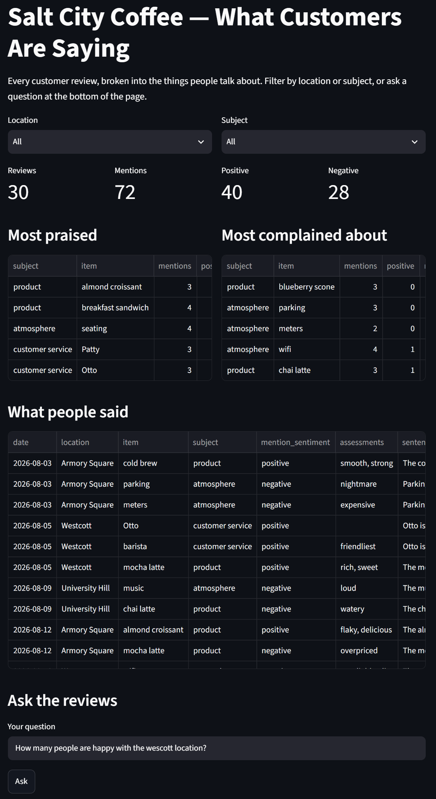

# IST356 Assignment 06 — What Are People Saying?

Salt City Coffee has three shops — Armory Square, Westcott and University Hill — and
the owner reads every customer review on the website. Thirty reviews in, she can tell
you that *somebody* hated the parking and *somebody* loves Otto, but not the things she
actually needs to know: is the mocha latte a hit or a problem? Is it the same at every
location? Is the wifi complaint one cranky customer or a pattern?

Reading harder will not answer those questions. Counting will — and counting needs
the reviews broken into pieces a computer can count: *who or what* each sentence is
about, and *how the writer feels about it*. That is a job for language AI, and you do
not have to train any: the **CENT iSchool IoT Portal** wraps Azure's language services
and a pair of AI models behind a REST API. You will call it, cache what it says, turn
the JSON into tables, and build a page where the owner can filter the results — or just
type "Do people like the mocha latte?" and get an answer built from the reviews, with
the evidence underneath.

This is Unit 4 in one assignment: HTTP requests and status codes (4-1), POST, API keys
and caching (4-2), and AI APIs — prompts, system prompts and temperature (4-3).

## Meta

### Learning Objectives

By the end of this assignment you will be able to:

1. **Call a REST API from Python** with `requests`: build the URL, send an API key in a header, choose form data or a JSON body, and read the JSON response
2. **Handle HTTP errors where they happen** with `raise_for_status()`, and explain what a 4xx or 5xx status means
3. **Keep a secret out of your code** — read an API key from a `.env` file that git never sees
4. **Respect a rate limit by caching**: call an API once, save the raw response, and read the cache on every later run
5. **Separate extract from transform**: the steps that call the network from the steps that only reshape data
6. **Flatten nested JSON with `pd.json_normalize`** using `record_path`, `meta` and `record_prefix`, and walk JSON that is too deep for it with nested loops
7. **Combine two AI services** — opinion mining and named-entity recognition — so each covers what the other misses
8. **Use a decision model** to classify text into categories you define, and read its probabilities and confidence
9. **Summarize with pandas, write with an LLM**: compute the facts with a group-by, then give a language model only those facts and the evidence
10. **Build a Streamlit page around an AI pipeline**, with filters, metrics, and a question box that refuses to guess

### Assignment Layout

- `code/` — **where you write code.** Only files in this folder are reviewed for grading.
  - `reviews/` — the **pipeline package**
    - `__init__.py` — **provided.** The package's public API
    - `settings.py` — **provided.** The portal's address, your key, file locations, the AI model's questions
    - `apicalls.py` — **Step 1, you write this.** One function per API endpoint (walked through line by line)
    - `pipeline.py` — **Step 2, you write this.** Cached API steps; JSON into tables (the steps described)
    - `aspects.py` — **Step 3, you write this.** Mentions, summaries, and the Q&A box's pieces (**on your own**)
  - `review_explorer.py` — the **Streamlit page** (**on your own**)
  - `explore.py` — **provided.** Runs the pipeline one step at a time so you can debug it
  - `reflection.txt` — **where you write your reflection** (graded)
- `data/` — `reviews.csv` (30 reviews), `reviews_test.csv` (5 reviews you can check by hand), `aliases.csv`
- `cache/` — created by your pipeline; holds the API's answers. **Not committed** (it is in `.gitignore`)
- `tests/` — the automated tests, and `tests/fixtures/` — the portal's recorded answers for the 5 test reviews
- `grader/` — the autograder used by GraderThan (you don't touch this)
- `.devcontainer/`, `.streamlit/`, `.vscode/` — container, Streamlit and editor configuration
- `README.md`, `reflection.md`, `rubric.json`, `requirements.txt`, `ruff.toml` — these instructions, reflection guidance, grading, dependencies, style rules

You write **seventeen functions** across three modules — most are under ten lines — and
**one Streamlit page**.

### Prerequisites

Same environment as Assignments 01–05, plus one new thing: **a CENT iSchool IoT Portal
API key.** Log in at https://portal.app.cent-su.org with your SU account; your key is on
the Home page. Then do [Reference #1](#1-how-do-i-set-up-my-api-key) before anything else.

---

## Prep — Open the assignment

Same as before: **first fork, then** open your fork in Codespaces (**Option A**) or a
local dev container (**Option B**).

1. **Fork this repository.** At the top-right of this repo's GitHub page, click **Fork**.
   You submit and are graded on *your fork*.

### Option A — GitHub Codespaces (in the browser) ⭐ easiest

1. On **your fork's** page, click **Code → Codespaces → Create codespace on main**.
2. VS Code opens in the browser, inside the course container, with Git signed in.

> Stop your Codespace when you're done (`github.com/codespaces` → **⋯ → Stop codespace**) —
> the free hours are monthly.

### Option B — Your own computer (local dev container)

1. Clone **your fork** (`Ctrl+Shift+P` → **Git: Clone**, or
   `git clone https://github.com/YOUR-GITHUB-USERNAME/assignment_06.git`).
2. **File → Open Folder** → `assignment_06` → **Reopen in Container**.

### Check you're ready

1. Create your `.env` file ([Reference #1](#1-how-do-i-set-up-my-api-key)).
2. Open the **Testing** panel and run the tests ([Reference #10](#10-how-do-i-run-automated-tests)).
   You should see **0 passing and 45 failing** — every test is about a function you
   haven't written yet.

---

## About the data — read this before you start

**`data/reviews_test.csv`** — five reviews written so that every part of the pipeline has
something to find. You can check every result by hand, and the tests do exactly that:

| id | location | review |
| --- | --- | --- |
| T1 | Armory Square | Pete the barista made my oat milk cortado perfectly. The almond croissant was flaky and delicious. |
| T2 | Westcott | The mocha latte was overpriced and lukewarm. The wifi kept dropping, so I couldn't get any work done. |
| T3 | University Hill | I love the comfortable seating by the window, but the music is way too loud. Patty at the register was quick even with a long line. |
| T4 | Armory Square | The cold brew was smooth and delicious. The blueberry scone was dry and stale. Tally at the register forgot my order. |
| T5 | Westcott | Best mocha latte in Syracuse! The new murals make the place feel cozy, and Otto always says hi. |

When your pipeline is done, those five reviews become **14 mentions**:

| item | subject | feeling | why (assessments) | found by |
| --- | --- | --- | --- | --- |
| Pete | customer service | positive | | entity |
| oat milk cortado | product | positive | | entity |
| almond croissant | product | positive | flaky, delicious | opinion |
| mocha latte | product | negative | overpriced, lukewarm | opinion |
| wifi | atmosphere | negative | dropping | opinion |
| seating | atmosphere | **positive** | love, comfortable | opinion |
| music | atmosphere | **negative** | too loud | opinion |
| Patty | customer service | positive | quick | opinion |
| cold brew | product | positive | smooth, delicious | opinion |
| blueberry scone | product | negative | dry, stale | opinion |
| Tally | customer service | negative | | entity |
| mocha latte | product | positive | Best | opinion |
| murals | atmosphere | positive | cozy | opinion |
| Otto | customer service | positive | | entity |

Look at T3's first sentence: one sentence, two opposite opinions. Sentence-level
sentiment calls the whole sentence *negative*; opinion mining gets the seating right.
And look at "found by": Pete, Tally and Otto have no opinion words attached, so opinion
mining misses them — the entity recognizer knows they are people.

**`data/reviews.csv`** — the 30 real reviews, August through October, ten per location.
That is what the page shows: **72 mentions** — 40 positive, 28 negative — of 29 different items.

**`data/aliases.csv`** — the same thing called different names: Azure sometimes calls
the cold brew just "brew", and "Parking downtown" is still parking. Each alias maps to one
item name; staff names map to their capitalized form.

**The portal.** Base URL `https://portal.app.cent-su.org`, your key in an `X-API-KEY`
header. **150 requests per day** — but a request the portal has answered before comes
from its cache and **does not count**. The whole pipeline on the 30 reviews is about 60
calls the first time anyone runs it, and free after that.

| endpoint | method | body | gives you |
| --- | --- | --- | --- |
| `/api/azure/sentiment` | POST | form: `text` | sentences, each with a sentiment, **targets** and **assessments** (opinion mining) |
| `/api/azure/entityrecognition` | POST | form: `text` | entities: `text`, `category` (Person, Product, ...), `offset` |
| `/api/ollama/systemone` | POST | JSON: `state`, `questions` | a fast **decision model**: one answer per question, with probabilities and a confidence |
| `/api/ollama/chat/completions` | POST | JSON: a list of messages; `temperature` in the query string | a **language model**'s reply |

The full list is at https://portal.app.cent-su.org/doc.

---

## Walkthrough — Do the assignment step by step

### The training wheels come off

| module | what you get |
| --- | --- |
| `apicalls.py` — Step 1 | every docstring ends with a **How to build it** that is nearly line by line |
| `pipeline.py` — Step 2 | docstrings describe the steps in words |
| `aspects.py` — Step 3 | docstrings state the contract and nothing else |
| `review_explorer.py` | the goal, the widgets, the exact labels |

### Build order at a glance

| order | write this | turns green |
| --- | --- | --- |
| 1 | `get_sentiment`, `get_entities`, `classify_mentions`, `ask_llm` | `test_unit.py` — all but `item_name` |
| 2 | `sentiment_step`, `entities_step` | `test_pipeline.py -k calls_then` |
| 3 | `sentences_table`, `opinions_table`, `entities_table` | `test_pipeline.py -k table` |
| 4 | `item_name`, `entity_mentions`, `subjects_step`, `build_mentions`, `analyze_reviews` | `test_unit.py -k item_name`, `test_pipeline.py -k "mentions or subjects or end_to_end"` |
| 5 | `summarize_items`, `question_items`, `build_messages` | `test_pipeline.py -k "summarize or question or messages"` |
| 6 | `review_explorer.py` | `test_pipeline.py -k app` |
| 7 | *(structure checks go green along the way)* | `test_code.py` |
| 8 | `reflection.txt` | — |

The transform tests use **recorded** portal answers (`tests/fixtures/`), so a table test
passes when *that* function is right, even if your API functions aren't finished.

### Step 1 — Your key, and what you've been given

Do [Reference #1](#1-how-do-i-set-up-my-api-key). Then read `code/reviews/settings.py`:
it knows where the portal is, finds your key, and holds the exact wording of the
questions the decision model is asked. Open https://portal.app.cent-su.org/doc and find
the four endpoints in the table above.

### Step 2 — Part 1: `apicalls.py`, one function per endpoint

Four functions, one algorithm ([Reference #2](#2-what-is-the-algorithm-for-calling-an-api)).
Follow each **How to build it**. The two differences between them are the whole lesson
of 4-2: the Azure endpoints take a **form** (`data=`), the AI endpoints take **JSON**
(`json=`) — [Reference #3](#3-form-data-or-json). Run `pytest tests/test_unit.py`: the
"request" tests check what you send without using the network; the "live" tests make one
real call each.

### Step 3 — Commit and get early feedback

Commit `step 1: api calls`, push, and submit to GraderThan
([Reference #14](#14-how-do-i-submit-for-grading--and-review-my-feedback--with-graderthan)).

### Step 4 — Part 2: `pipeline.py`, cache it, then flatten it

1. **`sentiment_step`, `entities_step`** — the caching pattern
   ([Reference #6](#6-how-do-i-cache-api-calls)): if the cache file exists, read it;
   otherwise call once per review, add `review_id` to each document, save, return.
2. **`sentences_table`** — your first `json_normalize` with `record_path`, `meta` and
   `record_prefix` ([Reference #5](#5-how-do-i-flatten-json-into-a-dataframe)).
3. **`opinions_table`** — targets point at their assessments by reference
   ([Reference #4](#4-how-do-i-read-the-sentiment-response)). Too deep for one
   `json_normalize`: nested loops.
4. **`entities_table`** — `json_normalize` again, keeping people and products.

Run `code/explore.py` — it runs these on the five test reviews and prints each table.
Compare with the table in *About the data*.

### Step 5 — Commit

Commit `step 2: pipeline`, push, submit.

### Step 6 — Part 3: `aspects.py` *(on your own)*

The docstrings are the spec. `entity_mentions` places each entity in the sentence whose
span contains it and drops the ones opinion mining already found. `subjects_step` (back
in `pipeline.py`) asks the decision model what each mention is about
([Reference #7](#7-how-do-i-use-the-decision-model)) — slow the first time, seconds per
mention, instant after. `build_mentions` puts everything together; `analyze_reviews`
chains it all. Then `summarize_items` (a group-by, as in A5), `question_items` and
`build_messages` ([Reference #8](#8-how-do-i-talk-to-the-language-model)).

### Step 7 — Commit

Commit `step 3: aspects`, push, submit.

### Step 8 — The app: `review_explorer.py` *(on your own)*

| widget | key | shows |
| --- | --- | --- |
| `st.title` | | `Salt City Coffee — What Customers Are Saying` |
| `st.selectbox` ×2 | `location`, `subject` | `"All"` plus each location / subject |
| `st.metric` ×4 | | `Reviews`, `Mentions`, `Positive`, `Negative` — for the filtered mentions |
| `st.dataframe` ×3 | | most praised (net > 0, top 5), most complained about (net < 0, top 5), what people said |
| `st.text_input` | `question` | the owner's question |
| `st.button` | `ask` | **Ask** |
| `st.warning` | | when no mentions match the question — and then **no** call to the model |

When **Ask** is clicked: `answer_question` (provided) finds the items and the evidence,
`build_messages` writes the conversation, `ask_llm` answers; show the answer, a caption
naming the items, and the evidence table. The page reads the reviews file from the
`REVIEWS_FILE` environment variable when it is set (the tests point it at the five test
reviews) and from `REVIEWS_FILE` in the package otherwise.

The first time you run the page on the 30 reviews it builds the cache (a few minutes if
you are the first person to run it, seconds otherwise). Try *"Do people like the mocha
latte?"* — then pick each location in the filter and see why the answer mentions
locations.



### Step 9 — Commit

Commit `review explorer`, push, submit.

### Step 10 — Reflection, then final submit

Read `reflection.md`, write `code/reflection.txt`, commit `assignment complete`, push,
submit, read your feedback, fix anything flagged.

---
## Reference — How do I…?

### 1. How do I set up my API key?

1. Log in at https://portal.app.cent-su.org and copy your key from the Home page.
2. At the **root of the repository** (next to this README), create a file named `.env`
   containing one line:

   ```
   CENT_API_KEY=paste-your-key-here
   ```

3. That's it. `get_api_key()` in `settings.py` reads it with **python-dotenv**:
   `load_dotenv()` copies each `NAME=value` line of `.env` into the environment
   variables, and `os.environ.get("CENT_API_KEY")` reads it from there. It is the standard
   way Python projects keep secrets out of their code, and you will see it again.
   `.env` is in `.gitignore`, so Source Control never offers to commit it — check that it
   does not appear there.

**Never paste your key into a `.py` file.** Your fork is public; a key in a commit is a
key anyone on the internet can use, and `git` remembers it even after you delete the
line. `test_code.py` fails if anything in `code/` looks like a key. (In Codespaces you
can use a Codespaces secret named `CENT_API_KEY` instead of `.env`.)

### 2. What is the algorithm for calling an API?

From lesson 4-1, every time:

```python
url = f"{BASE_URL}/api/azure/sentiment"         # 1. where
headers = {"X-API-KEY": get_api_key()}          # 2. who you are
response = requests.post(url, headers=headers, data={"text": text})   # 3. ask
response.raise_for_status()                     # 4. stop here if it failed
return response.json()                          # 5. the answer, as Python dicts and lists
```

`raise_for_status()` turns a status code of 400 or more into an exception *at the line
that caused it*. **401** means your key is missing or wrong; **404** means a typo in
the path; **429** means you are over your daily limit; **5xx** means the server had a
problem. Without it, an error comes back as a normal-looking dict and your code fails
somewhere else, later, with a `KeyError`.

### 3. Form data or JSON?

| you write | requests sends | used by |
| --- | --- | --- |
| `data={"text": text}` | a form, like a web page's `<form>` | the Azure endpoints |
| `json=body` | the dict or list as JSON, with `Content-Type: application/json` | the AI endpoints |
| `params={"temperature": 0}` | `?temperature=0` on the URL (the query string) | anywhere |

The API's documentation says which each endpoint wants. Send the wrong one and you get a
4xx — which `raise_for_status()` reports immediately.

### 4. How do I read the sentiment response?

`response["results"]["documents"][0]` is one document. Abbreviated, for T2:

```json
{"sentiment": "negative",
 "sentences": [
   {"text": "The mocha latte was overpriced and lukewarm. ", "sentiment": "negative",
    "offset": 0, "length": 45,
    "targets": [
      {"text": "mocha latte", "sentiment": "negative", "offset": 4,
       "relations": [{"relationType": "assessment", "ref": "#/documents/0/sentences/0/assessments/0"},
                     {"relationType": "assessment", "ref": "#/documents/0/sentences/0/assessments/1"}]}],
    "assessments": [
      {"text": "overpriced", "sentiment": "negative"},
      {"text": "lukewarm", "sentiment": "negative"}]}, ...]}
```

A **target** is what the writer has an opinion about; an **assessment** is the opinion
word. A target's `relations` say which assessments belong to it: the number at the end of
`ref` is the assessment's position in the same sentence's `assessments` list —
`int(ref.split("/")[-1])`. `offset` is where the text starts, counted in characters from
the start of the review.

### 5. How do I flatten JSON into a DataFrame?

```python
pd.json_normalize(documents, record_path="sentences", meta=["review_id"],
                  record_prefix="sentence_")
```

- `record_path` — the list inside each document to turn into rows (one row per sentence)
- `meta` — fields from the parent document to copy onto every one of those rows
- `record_prefix` — put in front of every field from the list, so `text` becomes
  `sentence_text` and nothing collides with a parent field

Nested dicts become dotted columns (`sentence_confidenceScores.positive`). When the data
is deeper than one list, or rows must be joined by reference, plain nested `for` loops
that append dicts to a list — then `pd.DataFrame(rows)` — are clearer than any one call.

### 6. How do I cache API calls?

```python
if os.path.exists(cache_file):                 # been here before?
    with open(cache_file) as fh:
        return json.load(fh)                     # no API calls at all
results = [...call the API once per review...]
with open(cache_file, "w") as fh:
    json.dump(results, fh)                       # next time, read this
return results
```

The cache is *your* copy of what the API said: it works offline, it makes the transform
steps instant to debug, and it is why a rate limit stops being a problem. Delete a cache
file to redo that step. `cache_path(reviews_file, "sentiment")` gives each reviews file
its own cache file.

### 7. How do I use the decision model?

`/api/ollama/systemone` answers typed questions about a piece of text — the `state` —
in one request. `settings.subject_questions(mentions)` builds one `choice` question per
mention; you send:

```python
{"state": {"review": review_text}, "questions": subject_questions(["mocha latte", "wifi"])}
```

and each answer comes back under its mention:

```json
{"answers": {"mocha latte": {"choice": "product",
                             "probabilities": {"customer service": 0.001, "atmosphere": 0.002,
                                               "product": 0.996, "other": 0.001},
                             "confidence": 0.98}, ...}}
```

`confidence` is how sure the model is — worth keeping, because it is sometimes wrong.
Send the questions **exactly** as `subject_questions` writes them, mentions in order of
where they appear: the portal answers from its cache only when a request is
byte-for-byte the same, and the first time a question is asked it takes seconds.

### 8. How do I talk to the language model?

A **chat completion** takes the whole conversation as a list of messages:

```python
[{"role": "system", "content": "You answer questions about ... Use only the facts provided."},
 {"role": "user", "content": "Question: ...\nFacts: ...\nReview sentences:\n- ..."}]
```

The **system prompt** sets the rules; the **user** message carries the question and
everything the model is allowed to know. `temperature=0` makes it pick the most likely
words every time — the same question gets the same answer, and the portal can cache it.
The reply is at `["choices"][0]["message"]["content"]`.

This pattern — find the relevant data yourself, put only that in the prompt — is called
**retrieval-augmented generation**, and it is how most real AI features work. It is also
why `build_messages` gives the model the *counts*: language models are bad at counting
and good at writing. pandas counts; the model writes.

### 9. How do I debug a pipeline step?

Run `code/explore.py` with **Python Debugger: Current File**, with a breakpoint inside
the function you are writing. It runs the pipeline on the five test reviews, from
`cache/` after the first time. In the **VARIABLES** panel, expand `documents` to read
the raw JSON your table function is about to flatten.

### 10. How do I run automated tests?

**Testing** panel (View → Testing) → ▶. Or from a terminal at the repository root:

```
pytest tests/test_unit.py -v
pytest tests/test_pipeline.py -k table        # one group at a time
pytest tests/test_code.py -v
```

If every live test fails with *No API key found*, see [Reference #1](#1-how-do-i-set-up-my-api-key).
If the Testing panel shows no tests at all, `reviews/__init__.py` cannot import a
function — a deleted or misspelled function name. Scroll up to the `ImportError`.

### 11. How do I commit my changes in VS Code?

View → Source Control → message → **Commit**. Make sure `.env` and `cache/` are **not**
in the list of changes (they shouldn't be — `.gitignore` hides them).

### 12. How do I push my code to GitHub?

Source Control → **Sync Changes**.

### 13. How do I see my code on GitHub?

`https://github.com/YOUR-GITHUB-USERNAME/assignment_06`. If your change isn't there, it
isn't pushed. If your key *is* there, tell your instructor so it can be replaced.

### 14. How do I submit for grading — and review my feedback — with GraderThan?

GraderThan runs the autograder (with its own API key — yours never leaves your
computer), the code style checks ([Reference #15](#15-how-do-i-check-my-code-style)) and
an AI reviewer (reflection) against your fork.

1. Go to **https://graderthan.cent-su.org** and log in with your SU Microsoft account.
2. Click this assignment on **Your dashboard**.
3. First time only: **Profile → Connect GitHub**.
4. Under **Request grading**, submit your fork's URL. **Commit and push first.**

### 15. How do I check my code style?

The **Code style & readability** point is four checks on everything in `code/`, and
**all four** must pass:

| check | how to see it yourself |
| --- | --- |
| no `# TODO` comments left | search `code/` for `TODO` — the starter has one in every function you write |
| no leftover `pass` stubs | every `pass` the starter left where a body goes is replaced by your code |
| a docstring on every function | keep the starter's; give any helper you add its own |
| no lint errors | run `ruff check` at the repository root — **no output means it passes** |

`ruff check` reads `ruff.toml`, which holds exactly the grader's rules. On an untouched
checkout it already reports unused imports in `apicalls.py`, `pipeline.py` and
`aspects.py` — the names your function bodies are about to use. They disappear as you
write them. (Don't let `ruff check --fix` delete them.)

---
## How You're Graded

GraderThan scores this assignment out of **10 points** (see `rubric.json`):

| What | Points | Judged by |
| --- | --- | --- |
| **Unit Tests** — `test_unit.py` (the four API functions: the request, and a live call; `item_name`) | 2 | automated tests |
| **Pipeline & App Tests** — `test_pipeline.py` (JSON into tables, the cached steps, the whole pipeline, the page) | 3 | automated tests |
| **Code Structure Tests** — `test_code.py` (the API algorithm, no key in code, caching, `json_normalize`, the page) | 2 | automated tests |
| **Code style & readability** — no `# TODO`s, no leftover `pass`, a docstring on every function, `ruff check` clean ([Reference #15](#15-how-do-i-check-my-code-style)) | 1 | automated style checks |
| Reflection quality | 2 | AI reviewer |

**Only files in the `code/` folder are graded.**
